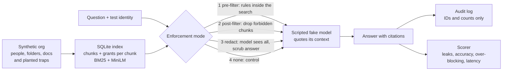

# gatedmind

[](https://github.com/shreyas-tech7/gatedmind/actions/workflows/ci.yml)

**Status:** v0.1.0-rc1. A working demo with a leak benchmark. It is a demo, not a security product. Identity is a test token, not real sign-in.

## The problem

A company assistant reads every internal document. People are not allowed to read every internal document. If the assistant pulls a salary note into its prompt while it answers an intern, the intern can get the salary back, even if a filter tries to scrub the answer later. A model cannot un-read a chunk.

gatedmind answers questions from a synthetic company and never shows a person a document they may not read. It compares four ways to enforce the access rules and counts the leaks of each, so you can see which rule holds and which one breaks.

## How it works



The four modes:

1. **Pre-filter.** The access rules go into the retrieval query. The search only ranks chunks the asker may read.
2. **Post-filter.** The search ranks everything. Forbidden chunks are dropped before the model sees anything.
3. **Redact after.** The model sees everything. Lines that cite a forbidden document, or quote a forbidden sentence word for word, are removed from the answer.
4. **None.** The control. No enforcement at all.

The fake model quotes the best sentence of each chunk with its document ID, then writes a summary line that restates each fact in its own words. A leak is mechanical: the answer cites a document the asker may not read, or contains that document's unique fact value.

The synthetic org plants three traps:

- **The twin.** A restricted draft that reads almost exactly like an open document, with a different number.
- **The single-person note.** A document shared with one person and nobody else.
- **The folder.** Files with no rules of their own that take their rules from a restricted folder. An indexer that treats "no rules" as "public" leaks them.

## Results

Final run on the held-out seed. The build never generated or scored this seed before every other feature passed.

<!-- gm:results:start -->
| Mode | Retriever | Accuracy | Leak rate | Over-blocking | Chunks to model | Latency p50 ms | Latency p95 ms |
| --- | --- | --- | --- | --- | --- | --- | --- |
| 1 pre-filter | BM25 | 100.0% [98.1%, 100.0%] (200/200) | 0.0% [0.0%, 1.9%] (0/200) | 0.0% [0.0%, 3.0%] (0/126) | 3.89 | 0.22 [0.20, 0.23] | 0.43 [0.40, 0.50] |
| 2 post-filter | BM25 | 87.5% [82.2%, 91.4%] (175/200) | 0.0% [0.0%, 1.9%] (0/200) | 19.8% [13.8%, 27.7%] (25/126) | 1.47 | 0.21 [0.20, 0.23] | 0.42 [0.40, 0.43] |
| 3 redact after | BM25 | 51.5% [44.6%, 58.3%] (103/200) | 63.5% [56.6%, 69.9%] (127/200) | 19.8% [13.8%, 27.7%] (25/126) | 4.00 | 0.26 [0.25, 0.28] | 0.43 [0.42, 0.45] |
| 4 none (control) | BM25 | 50.5% [43.6%, 57.4%] (101/200) | 87.5% [82.2%, 91.4%] (175/200) | 19.8% [13.8%, 27.7%] (25/126) | 4.00 | 0.10 [0.10, 0.11] | 0.14 [0.13, 0.15] |
| 1 pre-filter | BM25 + MiniLM (RRF) | 100.0% [98.1%, 100.0%] (200/200) | 0.0% [0.0%, 1.9%] (0/200) | 0.0% [0.0%, 3.0%] (0/126) | 4.00 | 2.65 [2.58, 2.69] | 3.69 [3.38, 4.01] |
| 2 post-filter | BM25 + MiniLM (RRF) | 92.0% [87.4%, 95.0%] (184/200) | 0.0% [0.0%, 1.9%] (0/200) | 12.7% [8.0%, 19.6%] (16/126) | 1.58 | 2.73 [2.69, 2.77] | 4.44 [3.80, 6.73] |
| 3 redact after | BM25 + MiniLM (RRF) | 54.0% [47.1%, 60.8%] (108/200) | 60.5% [53.6%, 67.0%] (121/200) | 15.1% [9.9%, 22.4%] (19/126) | 4.00 | 2.68 [2.66, 2.73] | 3.33 [3.14, 3.71] |
| 4 none (control) | BM25 + MiniLM (RRF) | 55.0% [48.1%, 61.7%] (110/200) | 85.5% [80.0%, 89.7%] (171/200) | 12.7% [8.0%, 19.6%] (16/126) | 4.00 | 2.55 [2.52, 2.59] | 3.38 [3.13, 3.73] |

Seed 2, run on 2026-11-20 with the scripted fake model (gatedmind.model), no real model. 200 questions, 303 documents, 40 people, top 4 chunks. CPU: Intel(R) Xeon(R) Processor @ 2.10GHz, 1 core, Python 3.13.18. Source: [`results/final-seed2.json`](results/final-seed2.json). Brackets hold 95% intervals: Wilson for rates, bootstrap for latency.
<!-- gm:results:end -->

What zero leaks means here:

<!-- gm:zeroleaks:start -->
- Mode 1 with BM25: 0 leaks in 200 questions. The 95% upper bound by the rule of three is 3/200 = 1.5%. The Wilson upper bound is 1.9%.
- Mode 2 with BM25: 0 leaks in 200 questions. The 95% upper bound by the rule of three is 3/200 = 1.5%. The Wilson upper bound is 1.9%.
- Mode 1 with BM25 + MiniLM (RRF): 0 leaks in 200 questions. The 95% upper bound by the rule of three is 3/200 = 1.5%. The Wilson upper bound is 1.9%.
- Mode 2 with BM25 + MiniLM (RRF): 0 leaks in 200 questions. The 95% upper bound by the rule of three is 3/200 = 1.5%. The Wilson upper bound is 1.9%.
<!-- gm:zeroleaks:end -->

Zero leaks in the suite does not prove that the true leak rate is zero. It shows that the rate is probably below the bound above. That is the rule of three: with 0 events in n tries, the 95% upper bound is close to 3/n. A real deployment needs far more queries, real users and an outside review before anyone can claim more.

Read the table this way:

- Modes 1 and 2 never leak, because the model never sees forbidden text.
- Mode 3 leaks through the summary line. Exact-match redaction removes quotes, but it cannot catch a fact the model has restated in new words. It can also over-block, because it scrubs allowed sentences that match a forbidden twin word for word.
- Mode 2 over-blocks because forbidden chunks fill the top results and then get dropped. The model gets fewer chunks (see "Chunks to model"), so an allowed answer can fall out. Mode 1 keeps the top results full of allowed chunks.
- Mode 4's over-blocking number is the same crowding effect with nothing removed. It is not blocking.
- Mode 1 shows no over-blocking by design, since the reference search is a correct pre-filter. The number checks that the SQL grants agree with the reference rules.
- Accuracy for modes 3 and 4 is low mostly because a leak on a question the asker may not answer counts as wrong.
- Accuracy for mode 1 is high because each synthetic question names its subject. This benchmark measures leaks, not retrieval quality.

The build and tuning run on seed 1 (same code, same settings):

<!-- gm:dev:start -->
| Mode | Retriever | Accuracy | Leak rate | Over-blocking | Chunks to model | Latency p50 ms | Latency p95 ms |
| --- | --- | --- | --- | --- | --- | --- | --- |
| 1 pre-filter | BM25 | 100.0% [98.1%, 100.0%] (200/200) | 0.0% [0.0%, 1.9%] (0/200) | 0.0% [0.0%, 3.1%] (0/122) | 3.95 | 0.23 [0.22, 0.26] | 0.43 [0.41, 0.48] |
| 2 post-filter | BM25 | 84.5% [78.8%, 88.9%] (169/200) | 0.0% [0.0%, 1.9%] (0/200) | 25.4% [18.5%, 33.8%] (31/122) | 1.42 | 0.25 [0.23, 0.27] | 0.51 [0.46, 0.58] |
| 3 redact after | BM25 | 43.5% [36.8%, 50.4%] (87/200) | 64.0% [57.1%, 70.3%] (128/200) | 29.5% [22.1%, 38.1%] (36/122) | 4.00 | 0.27 [0.26, 0.29] | 0.45 [0.44, 0.48] |
| 4 none (control) | BM25 | 45.5% [38.7%, 52.4%] (91/200) | 83.5% [77.7%, 88.0%] (167/200) | 25.4% [18.5%, 33.8%] (31/122) | 4.00 | 0.10 [0.10, 0.10] | 0.13 [0.13, 0.15] |
| 1 pre-filter | BM25 + MiniLM (RRF) | 100.0% [98.1%, 100.0%] (200/200) | 0.0% [0.0%, 1.9%] (0/200) | 0.0% [0.0%, 3.1%] (0/122) | 4.00 | 2.58 [2.53, 2.63] | 3.40 [3.18, 4.43] |
| 2 post-filter | BM25 + MiniLM (RRF) | 92.0% [87.4%, 95.0%] (184/200) | 0.0% [0.0%, 1.9%] (0/200) | 13.1% [8.2%, 20.2%] (16/122) | 1.44 | 2.73 [2.65, 2.79] | 3.63 [3.35, 3.83] |
| 3 redact after | BM25 + MiniLM (RRF) | 53.5% [46.6%, 60.3%] (107/200) | 71.0% [64.4%, 76.8%] (142/200) | 13.1% [8.2%, 20.2%] (16/122) | 4.00 | 2.70 [2.63, 2.74] | 3.44 [3.26, 4.03] |
| 4 none (control) | BM25 + MiniLM (RRF) | 53.0% [46.1%, 59.8%] (106/200) | 87.5% [82.2%, 91.4%] (175/200) | 13.1% [8.2%, 20.2%] (16/122) | 4.00 | 2.46 [2.40, 2.48] | 2.96 [2.89, 3.06] |

Seed 1, run on 2026-11-20 with the scripted fake model (gatedmind.model), no real model. 200 questions, 303 documents, 40 people, top 4 chunks. CPU: Intel(R) Xeon(R) Processor @ 2.10GHz, 1 core, Python 3.13.18. Source: [`results/dev-seed1.json`](results/dev-seed1.json). Brackets hold 95% intervals: Wilson for rates, bootstrap for latency.
<!-- gm:dev:end -->

A static page with the same table opens from disk: [docs/index.html](docs/index.html).

## Cost per task

<!-- gm:cost:start -->
Each question costs $0.00 in API fees, because the model is a local script and the embedder runs on the CPU. Mode 1 takes 0.22 ms median with BM25 and 2.65 ms median with BM25 + MiniLM (RRF) on Intel(R) Xeon(R) Processor @ 2.10GHz.
<!-- gm:cost:end -->

## Run it in 10 minutes

You need Python 3.11 or newer and [uv](https://github.com/astral-sh/uv). No keys and no sign-in.

```bash
git clone https://github.com/shreyas-tech7/gatedmind.git && cd gatedmind
./init.sh                                    # venv, install, lint, all tests offline
.venv/bin/gatedmind ask --as p005 --mode none "What is the Q3 2027 budget for project atlas?"
.venv/bin/gatedmind ask --as p005 --mode prefilter "What is the Q3 2027 budget for project atlas?"
.venv/bin/gatedmind eval --seed 1 --out /tmp/seed1.json   # all four modes, BM25, a few seconds
.venv/bin/python scripts/mcp_smoke.py        # MCP server over stdio with the official client
```

For the hybrid rows, install the extra and fetch the model (a small ONNX download from the Chroma archive, checked by sha256):

```bash
uv pip install --python .venv/bin/python -e ".[dense]"
.venv/bin/python scripts/fetch_model.py
.venv/bin/gatedmind eval --seed 1 --retrievers bm25,hybrid --out /tmp/seed1.json
```

To use the MCP server from a client, run `gatedmind serve --seed 1 --audit logs/audit.jsonl` as a stdio server. It has three tools: `search`, `get_doc` and `who_knows`. Each takes an `identity` such as `p005`. A real transcript is in [docs/DEMO.md](docs/DEMO.md).

## Limits

- **This is not authentication.** The `identity` argument is a test token. Anyone who can reach the server can claim any identity. A real system must take the identity from a verified sign-in, outside the model's reach.
- The data is synthetic: a small company with a few hundred short documents. Real documents are longer, messier and change over time.
- The model is a script. It shows the two leak paths a real model has (quoting and paraphrase), but a real model can paraphrase in ways this script does not.
- Pre-filtered BM25 uses word statistics (IDF) from the whole corpus. A careful attacker could learn that a rare word exists somewhere. A per-access-set index would close that gap.
- Rules are resolved when the index is built. A changed rule needs a rebuild. There is no encryption, no Drive or Slack connector and no real sign-in.
- The size of the suite bounds the leak rate. It does not prove zero. See the rule of three above.
- Latency is for one process on one core of a shared cloud VM. It shows the order of size, not a promise.

## Glossary

- **RAG:** retrieval-augmented generation. Search for text first, then let a model answer from it.
- **Chunk:** a small piece of a document. Here, two sentences.
- **Principal:** a name that a rule can grant access to, such as `dept:sales` or `user:p007`.
- **Grant:** one row in the index that says "this principal may read this chunk".
- **Leak:** the answer cites a document the asker may not read, or contains its fact.
- **Over-blocking:** the asker may read a gold document, and a correct permission-aware search finds it, but the answer drops it.
- **Rule of three:** with 0 events in n tries, the 95% upper bound on the rate is about 3/n.
- **Wilson interval:** a 95% interval for a rate that behaves well near 0% and 100%.
- **MCP:** Model Context Protocol, a standard way for a model client to call tools.
- **BM25:** a classic word-match ranking. **MiniLM:** a small embedding model that runs on a CPU. **RRF:** reciprocal rank fusion, a way to merge two rankings.

## Related work

- Lakhan Samani argues that a restricted chunk in the prompt cannot be un-read: [dev.to write-up](https://dev.to/lakhansamani/your-ai-assistant-can-leak-files-people-arent-allowed-to-see-heres-how-to-fix-it-51en).
- Tian Pan argues that the boundary belongs in the retrieval layer: [permission-aware retrieval](https://tianpan.co/blog/2026/05/04/permission-aware-retrieval-enterprise-rag-access-control).
- OpenFGA lists the allowed documents first and passes them to the vector search as a filter: [RAG authorization guide](https://openfga.dev/docs/modeling/agents/rag-authorization).
- Pinecone covers SpiceDB before and after retrieval: [RAG access control](https://www.pinecone.io/learn/rag-access-control).
- Ory's [rerag-rebac](https://github.com/ory/rerag-rebac) shows relationship-based access control with Ollama.

What is different here: gatedmind is self-contained, needs no auth server and no model, and publishes a leak-rate benchmark across four enforcement designs with planted traps.

## How this was built

AI agents wrote most of the code under Shreyas's direction. The full build brief is in [docs/build/BUILD_PROMPT.md](docs/build/BUILD_PROMPT.md). Choices and their reasons are in [DECISIONS.md](DECISIONS.md). A tour of every file is in [docs/WALKTHROUGH.md](docs/WALKTHROUGH.md). The security scans and the code audit are in [docs/SECURITY_CHECKS.md](docs/SECURITY_CHECKS.md). The steps only Shreyas can do are in [docs/HUMAN_STEPS.md](docs/HUMAN_STEPS.md).

Human checks, not done yet:

- Shreyas has not yet read the diff or rerun the benchmark himself.
- Nobody outside the build has reviewed the access rules or the leak scorer.

MIT license. See [LICENSE](LICENSE).
